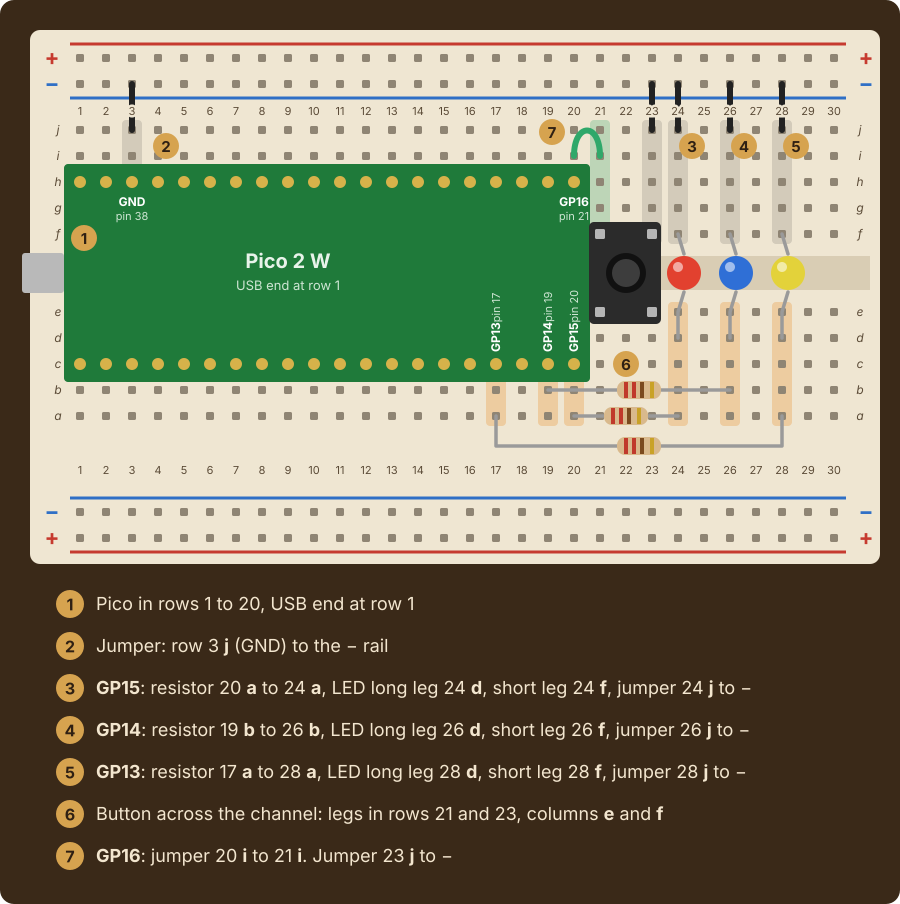

# Lab 5: Simon Memory Game

|Item |       |
|:----|:------|
|Released |Friday, October 16, at the lab session |
|Due |Friday, October 23, 2:30pm |
|Progress |[](../../actions/workflows/main.yml) |

Simon lights a sequence on your three LEDs, and you play it back with one button. On your
turn the lights take turns, one at a time, and you hold the button down while the light you
want is on. Simon's sequence and your answer are two lists, and the score compares them
position by position.

## Contents

* [Course learning outcomes](#course-learning-outcomes)
* [The circuit](#the-circuit)
* [The four stages](#the-four-stages)
  * [The Simon log](#the-simon-log)
  * [Expected output](#expected-output)
* [Getting started](#getting-started)
  * [Testing on your Pico](#testing-on-your-pico)
* [Evaluation](#evaluation)
  * [Programming, 3.0 points](#programming-30-points)
  * [Code quality and style, 1.0 point](#code-quality-and-style-10-point)
  * [Summary writing, 0.5 points](#summary-writing-05-points)
* [Code review](#code-review)
* [Submitting](#submitting)

## Course learning outcomes

This lab addresses the following course learning outcomes:

**CLO 1.** Apply Python programming fundamentals to execute and explain computer code that
implements interactive, novel solutions to a variety of computable problems.

**CLO 2.** Implement code consistent with industry-standard practices using professional-grade
integrated development environments (IDEs), command-line tools, and version control systems.

Specifically, by the end of this lab you should be able to:

* read a push button with `button.value()` and explain what a pull-up does
* repeat a block until the button is pressed with a `while` loop
* pick a random position in a list with `random.randint`
* build two lists with `append` and compare them one position at a time
* wire a push button to a GPIO pin on a breadboard

## The circuit

You need your Lab 4 circuit (three LEDs on GP15, GP14 and GP13), one push button, and two
jumper wires. Unplug the USB cable before you touch the wiring.

**Move the GP15 light from row 24 to row 30, leave the other two lights as they are, and add
the button**, following the
[Week 8 Session 3 slides](https://computationalexpression.com/slides/week-08-session-3/):



The button straddles the channel with its legs in rows 22 and 24, and its body covers rows 21
to 25. Pressing it joins rows 22 and 24, which connects GP16 to ground. If the program reads
the button as pressed when nothing touches it, turn the button a quarter turn.

If the button or a light will not work, ask an instructor or TL. Do not troubleshoot hardware
alone the night before it is due.

## The four stages

Everything this lab asks for is covered by the Week 8 Session 3 slides and the weeks before them.

**The story is yours to change.** Every message the program prints is your wording. Two things
stay fixed, because the automated checks depend on them: the questions are asked in the order
the starter lists them, and the Simon log at the end keeps its labels.

**Stage One: Simon's Sequence.** Ask the user's name and how many lights Simon should show.
`sequence` starts as an empty list and grows by one random position per light:
`random.randint(0, len(leds) - 1)`. Positions start at `0`, and `randint` includes both of its
ends.

**Stage Two: Watch.** A loop over `sequence` lights each one in turn with `leds[position]`.

**Stage Three: Your Turn.** `answer` starts as an empty list. For each step, the first light
comes on. A `while` loop keeps moving the light along every half second for as long as the
button reads `1`, and after the last light comes the first again. When the button reads `0`,
the light that is on is the answer: turn it off and append its position to `answer`.

**Stage Four: The Score.** Compare `answer` with `sequence` one position at a time, and count
the positions that match. When every position matches, the result is `PERFECT` and every
light flashes together; otherwise it is `TRY AGAIN`.

### The Simon log

The program ends with a log, and the automated checks read **only the log and which lights
came on**, never the story. The log has six lines, in this order:

```text
SIMON LOG: JJ
==================================================
Lights: 3
Sequence length: 4
Correct steps: 3
Result: TRY AGAIN
```

Print each line any of the three ways from Week 3: `print("Correct steps:", correct)`,
`print("Correct steps: " + str(correct))`, or `print(f"Correct steps: {correct}")` all pass.
The checks forgive extra spaces and letter case.

In the checks, Simon's sequence is chosen for you rather than at random, and a pretend player
presses the button when the light they want comes on. The checks type the answers in the order
the starter asks them: name, then how many lights.

### Expected output

One complete run on the board, with `4` lights, where the player missed the second step:

```text
==================================================
SIMON MEMORY GAME
==================================================
What is your name? JJ
How many lights should Simon show? (1-8): 4

Watch closely, JJ
Your turn: hold the button down while the light you want is on.
Step 1 answered with light 3
Step 2 answered with light 2
Step 3 answered with light 2
Step 4 answered with light 2

==================================================
SIMON LOG: JJ
==================================================
Lights: 3
Sequence length: 4
Correct steps: 3
Result: TRY AGAIN
```

## Getting started

Open `src/main.py` and work through the `TODO` markers in order. As you go, run it from the
terminal:

```text
uv run python src/main.py
```

This runs your program with plain Python on your laptop, without the hardware. It checks what
your program does, but no LED lights up, and the button always reads as pressed, so every
answer is the first light.

> [!IMPORTANT]
> Run every command in this README from the assignment's **working directory**, the top-level
> folder you land in right after cloning, not from inside `src`.

### Testing on your Pico

When your program is complete, play the game on your Pico to verify that it works on the
hardware. Plug in the board, open `src/main.py`, and click **Run** in the bar along the bottom
of the window. **Board Connected** must show beside it:


## Evaluation

This lab is worth **4.5 points**, the standard value for a lab in this course.

| Component | Points | What it measures |
|:----------|:-------|:-----------------|
| Programming | 3.0 | The 13 code checks below. Your score is the fraction passed, times 3.0 |
| Code quality and style | 1.0 | Descriptive names (0.3), clear organization (0.3), useful comments (0.4) |
| Summary writing | 0.5 | A complete, thoughtful `docs/summary.md` |
| **Total** | **4.5** | |

### Programming, 3.0 points

Run the checks yourself, as many times as you like, before you submit:

```text
uv run gatorgrade --config gatorgrade.yml
```

Each check's description says what to look at when it fails. Under a failed check, gatorgrade
also prints a `uv run pytest ...` command. Run it: the last lines say what came out wrong, what
was expected, and the sequence and presses that were used. Thirteen of the checks are about
your code:

* the Simon log names you, and `Lights` logs how many lights are in `leds`
* Simon picks each light with `random.randint(0, len(leds) - 1)`, once per light, and logs the
  length
* Simon's sequence `3`, `1`, `2`, `2` lights those lights in that order
* pressing on every right light logs every step correct and `PERFECT`
* one wrong press logs one step fewer and `TRY AGAIN`
* a player who lets their light go past once still answers it, because the light comes back
  round to the first
* the code calls `random.randint` and `append`, has a `while` loop that reads the button, loops
  over a list with `for`, and compares two lists by position
* no `TODO` markers remain, and there are at least six comments

Partial credit is proportional: passing 10 of 13 checks earns `(10 ÷ 13) × 3.0 = 2.3` points.

The remaining two checks look at `docs/summary.md`. They confirm the document is finished, and
they count toward Summary writing below rather than toward these 3.0 points.

> [!NOTE]
> Automated results are preliminary. Your instructor sets the final grade.

### Code quality and style, 1.0 point

Graded by a human reading your code. Descriptive variable names, sensible organization, and
comments that explain **why** rather than restating what the line already says.

### Summary writing, 0.5 points

Complete [`docs/summary.md`](docs/summary.md). Every question answered fully. Minimum word
count is `150`.

## Code review

A Technical Leader or the instructor will conduct a code review with you on this lab. **Code
reviews are graded separately from the 4.5 points above**, under the Code Reviews category on
the syllabus.

Two things happen, with you present:

1. **You play the game** on your board for the reviewer
2. **You answer questions about your own code**, including the concepts behind it

The reviewer opens a **Code Review** issue on your repository and fills it out during the
conversation. The reviewer asks one question about each of four concepts, in their own words
and about your own code, so the questions differ from student to student. Be ready to:

* **Picking at random**: explain why `randint` ends at `len(leds) - 1`, and what `sequence`
  holds
* **The button**: say what `button.value()` returns before and during a press, and why
* **The while loop**: explain what keeps the loop going, what ends a step, and how the light
  goes back to the first
* **Comparing two lists**: trace `correct` through the score loop for a given sequence and
  answer

**Your review must be completed during the lab session on the day this lab is due.** If you
know in advance that you cannot attend that lab, make arrangements to complete your review
beforehand at office hours. If you submitted this lab on time but missed the code review, you
can make it up at office hours within one week of the due date:

* **Technical Leaders**, listed on the calendar at
  [cis.allegheny.edu/community/news](https://www.cis.allegheny.edu/community/news/)
* **Dr. Jumadinova**, [book a time](https://janyljumadinova.com/office-hours/). Drop-ins are welcome
  during posted hours, but students who booked are seen first

## Submitting

Commit and push often. The last version pushed before the deadline is the one that gets
graded. If you need more time, apply a late token with
[this form](https://forms.gle/3nGbpaNrG96DpLLdA). One token covers both parts of a lab: the
submission and the code review.

**In the terminal:**

```text
git add src/main.py docs/summary.md
git commit -m "Complete the Simon memory game"
git push
```

**In VS Code**, the Source Control panel in the left sidebar does the same three steps:

1. Click **+** next to a changed file to stage it (this is `git add`)
2. Type a message in the box at the top, then click the checkmark (this is `git commit`)
3. Click **Sync Changes** (or the &uarr; arrow) to push

Either way, then open your repository on GitHub and confirm your latest changes are actually
there.
